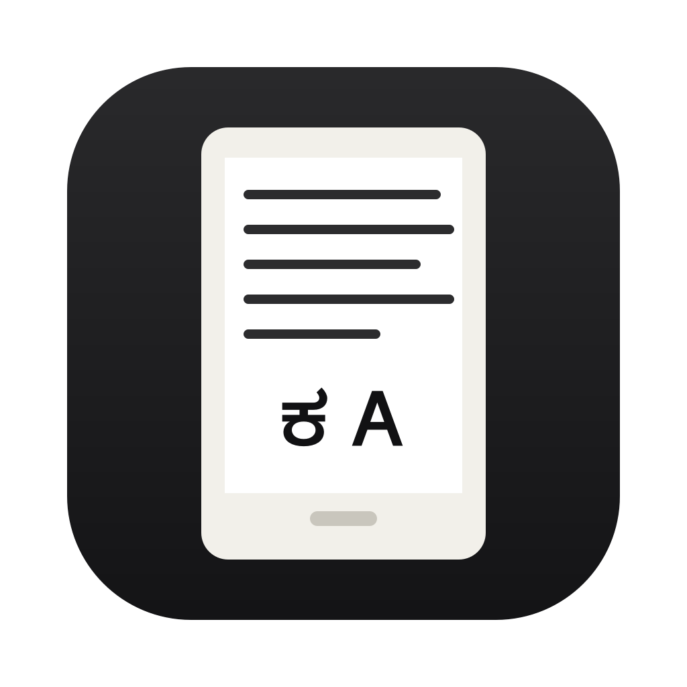
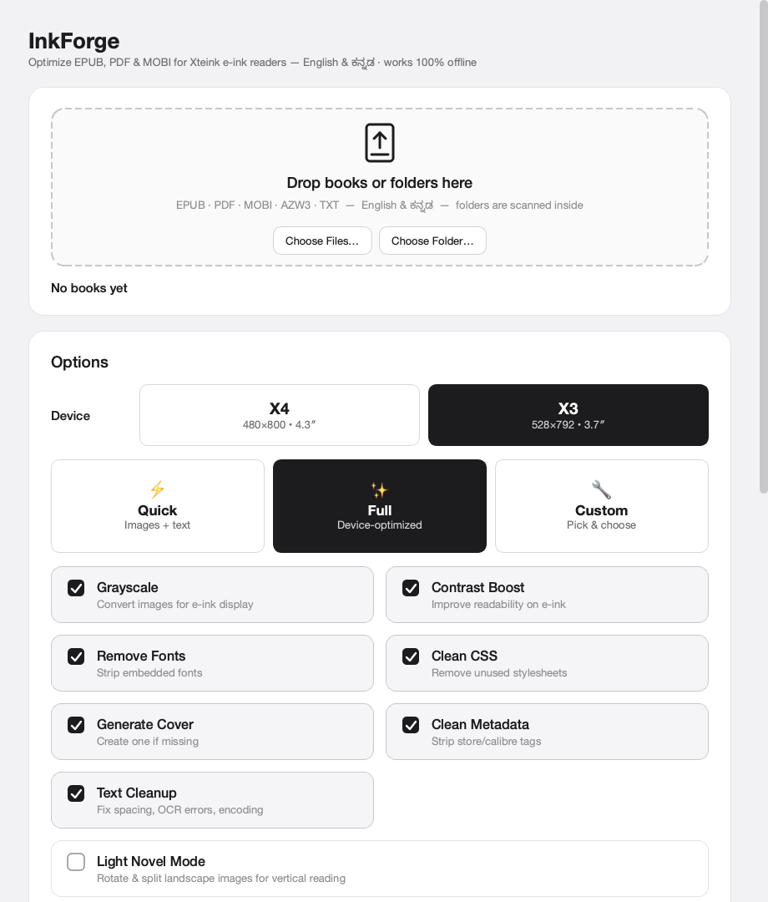
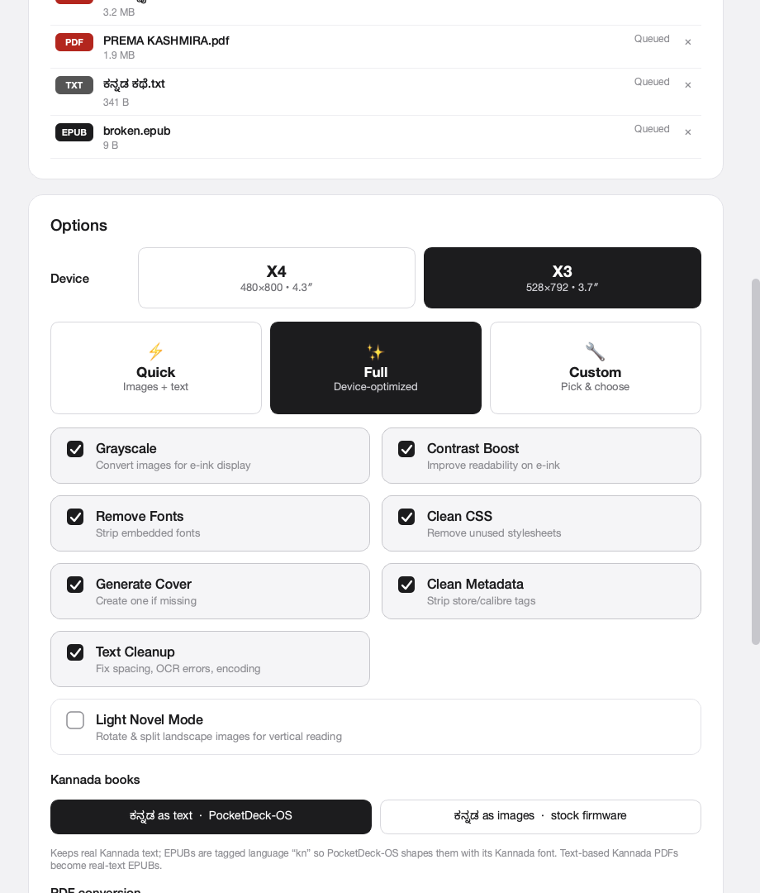
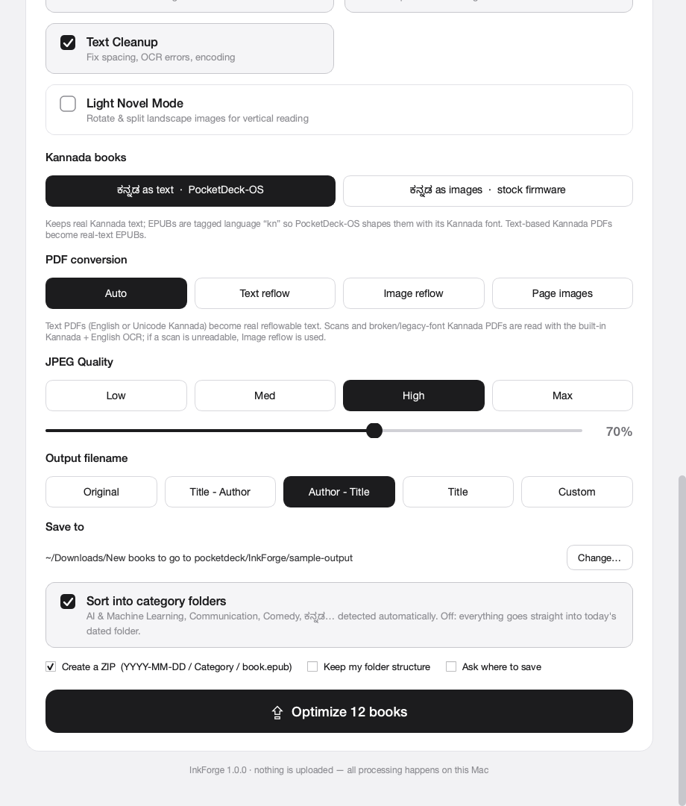
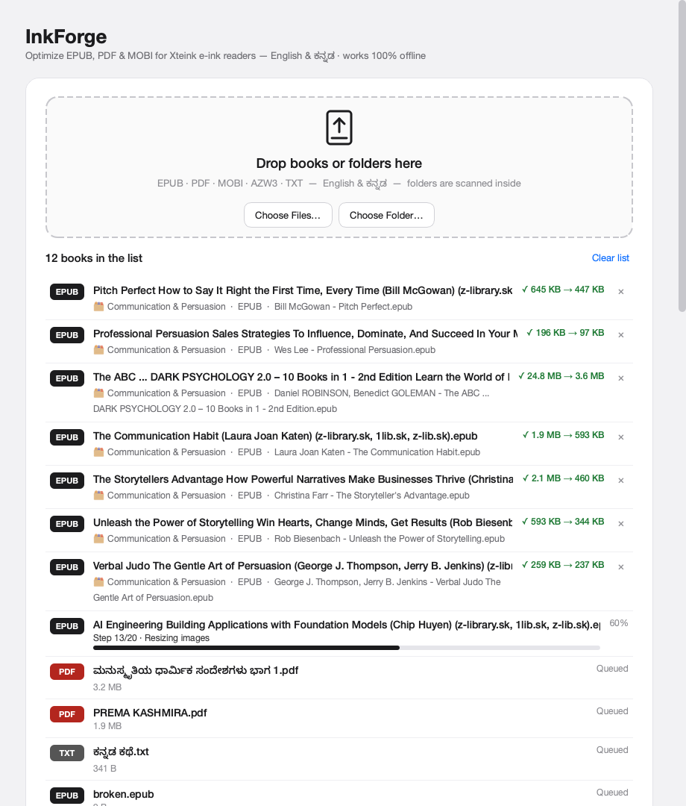
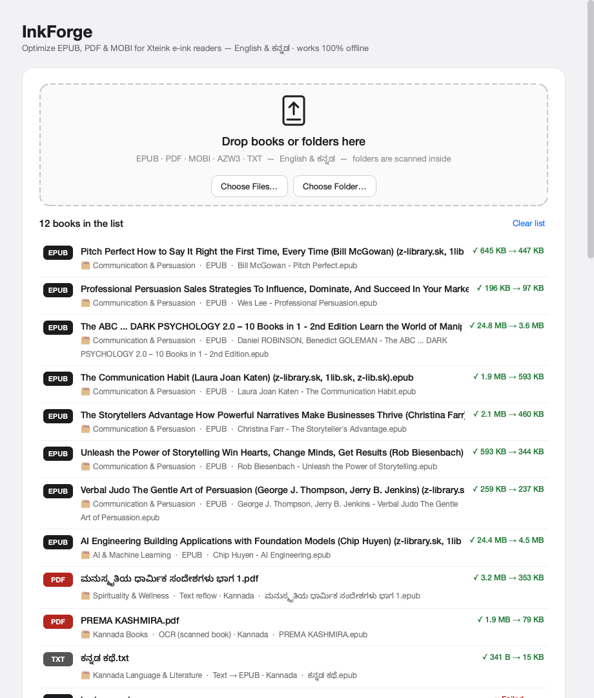
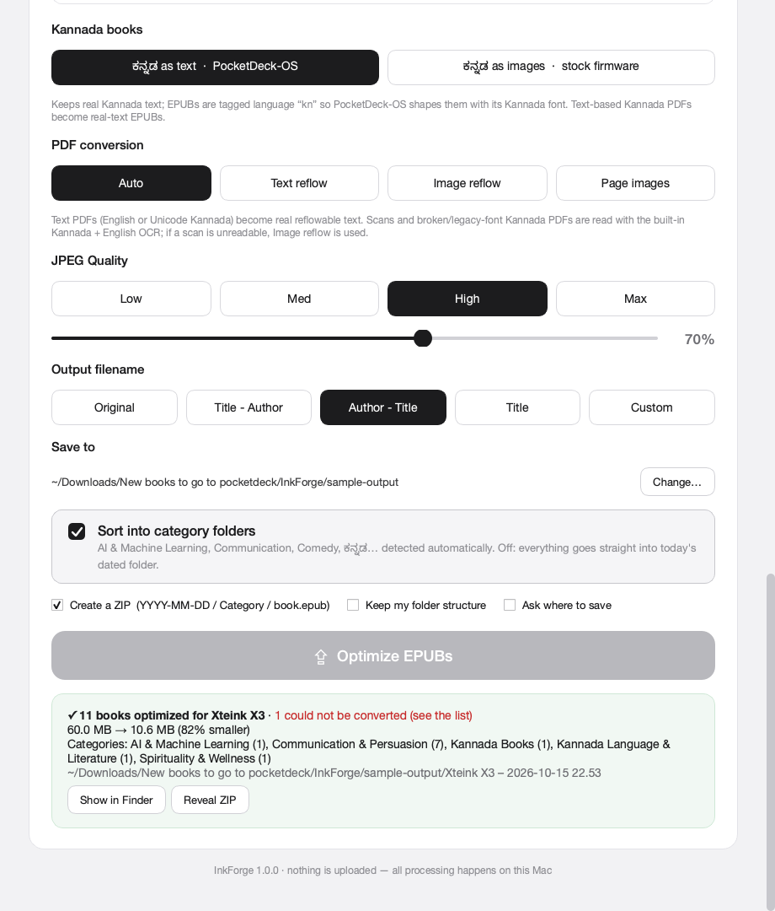

<p align="center">
  
</p>

<h1 align="center">InkForge</h1>

<p align="center">
  <b>An offline Mac app that turns EPUB, PDF and MOBI books into clean, small EPUBs for Xteink e-ink readers, in English and ಕನ್ನಡ.</b><br>
  A personal project by <b>Ashok Kumar Srinivas</b> · version 1.0.0 · macOS (Apple silicon)
</p>

---

## Contents

1. [What InkForge is](#what-inkforge-is)
2. [Salient features](#salient-features)
3. [Screenshots](#screenshots)
4. [Install](#install)
5. [How to use it](#how-to-use-it)
6. [Where you can use it](#where-you-can-use-it)
7. [What is implemented: the 20-step pipeline](#what-is-implemented-the-20-step-pipeline)
8. [PDF conversion in depth](#pdf-conversion-in-depth)
9. [Kannada support](#kannada-support)
10. [Output layout: dated folders, categories, ZIP](#output-layout-dated-folders-categories-zip)
11. [Options reference](#options-reference)
12. [Error handling](#error-handling)
13. [Measured results](#measured-results)
14. [Command line](#command-line)
15. [Project structure](#project-structure)
16. [Building from source](#building-from-source)
17. [Limitations](#limitations)
18. [Author](#author)

---

## What InkForge is

Most ebooks are made for phones, tablets and colour screens. On the Xteink **X4** (480×800, 4.3″) and **X3** (528×792, 3.7″), which have 4-level grayscale e-ink screens, those books cause problems:

* Images of 10–25 MB each slow down page turns.
* Progressive JPEGs decode at 1/8 resolution and look blurry.
* Embedded fonts and heavy CSS waste memory.
* Colour pictures turn muddy grey.
* PDFs don't reflow at all.

Kannada adds its own problems. Many Kannada PDFs have broken or legacy (Nudi/Baraha) text layers, and stock firmware can't shape Kannada script.

InkForge is a drag-and-drop desktop app, similar to [epubkit.ink](https://epubkit.ink/), that fixes all of this **on your Mac, with no internet and no upload**. Drop in single books or whole folders. You get optimized EPUBs, sorted into dated and categorised folders, plus one ZIP ready to copy onto the reader's SD card.

---

## Salient features

| | Feature |
|---|---|
| 📱 | **Device profiles** for the Xteink X4 (480×800) and X3 (528×792). Every image and cover is sized for the screen you pick. |
| 🖱️ | **Drag and drop** files or whole folders onto the window or the Dock icon. Folders are scanned recursively. |
| 📚 | **Many input formats:** EPUB, PDF, MOBI, AZW, AZW3, PRC and TXT. FB2, DOCX, RTF, ODT and HTML also work when Calibre is installed. |
| ⚡✨🔧 | **Quick / Full / Custom** presets, plus seven individual toggles and Light Novel mode. |
| 🖼️ | **E-ink image tuning:** grayscale, autocontrast and mid-tone gamma, sharpening, fit-to-screen, **baseline** JPEG or 16-grey PNG (whichever is smaller), and SVG rasterizing. |
| 🧹 | **Clean-up:** removes embedded fonts and unused CSS/images, simplifies CSS to what the firmware supports, and strips scripts and forms. |
| 🏷️ | **Metadata clean-up:** strips calibre/store/z-library tags, fixes `Last, First` author names, and removes junk titles and user-name authors. |
| ✍️ | **Text clean-up:** fixes mojibake (`’` → `’`), ligatures (`fi` → `fi`), stray spacing and OCR slips. Unicode is normalized to NFC. |
| 📄 | **PDF to EPUB, four ways:** Text reflow, OCR, Image reflow (k2pdfopt-style) or Page images. **Auto** picks one per book after checking the PDF. |
| 🔎 | **Built-in Kannada + English OCR:** the Tesseract 5.5 engine and the `kan`, `eng` and `osd` language data ship **inside the app**. You don't need to install anything. |
| ಕ | **First-class Kannada:** text-layer quality scoring, repair of the MS-Word duplication bug, `dc:language=kn` tagging for PocketDeck-OS, an optional Kannada-as-images mode for stock firmware, and Kannada OCR. |
| 🗂️ | **Automatic categorisation** into AI & Machine Learning, Programming, Communication, Business, Comedy & Humor, Spirituality, Kannada Literature and more. One switch turns it off. |
| 📦 | **Dated output and ZIP:** `YYYY-MM-DD / Category / Title - Author.epub`, both on disk and inside the ZIP. |
| 🧾 | **Output filenames:** Original, Title - Author, Author - Title, Title, or a custom pattern (`{title} {author} {device} {original} {lang}`). Names are safe for the FAT32 SD card. |
| 🎨 | **Covers:** an existing cover is resized to the screen; a missing one is generated as a typographic cover, with correct Kannada shaping. |
| 📑 | **Table of contents:** the NCX and EPUB 3 nav are repaired or rebuilt from headings or PDF bookmarks. |
| 🛡️ | **Graceful failures:** DRM, password-protected PDFs and damaged files each get a plain-English reason, and the rest of the batch continues. |
| 🔒 | **100% offline and private:** no network calls and no telemetry. |
| ⌨️ | **Command line** mode for scripting large libraries. |

---

## Screenshots

**Welcome: the drop zone and options**



**Options: device, preset and feature toggles**



**Kannada, PDF, JPEG quality, filename and output settings**



**Batch in progress. Books are processed one at a time, each with a live step counter (Step 8/20).**



**Results: per-book before→after sizes, category, method and warnings. Failed files are explained.**



**Summary: total savings, categories created, Show in Finder and Reveal ZIP**



---

## Install

1. Open **`dist/InkForge-1.0.0.dmg`**.
2. Drag **InkForge** onto **Applications**.
3. Open InkForge from Launchpad or Applications.

That is all. The OCR engine and the Kannada and English language data are **inside the app**, so there is nothing else to install.

The app is ad-hoc signed, not notarized. If macOS warns about it on another Mac, right-click the app, choose **Open**, then click **Open** again.

You can also run **`dist/InkForge.app`** directly without installing.

**Optional:** install [Calibre](https://calibre-ebook.com) for the best MOBI/AZW3 conversion and for FB2, DOCX and RTF input. Without it, the built-in MOBI/AZW3 unpacker is used.

---

## How to use it

1. **Add books.** Drop files or folders on the dashed area, or use **Choose Files…** / **Choose Folder…**.
2. **Pick the device:** X4 or X3.
3. **Pick a preset:**
   * **Quick:** images and text only.
   * **Full:** everything tuned for the device. This is the recommended preset.
   * **Custom:** you choose the toggles. Clicking any toggle switches the preset to Custom.
4. **Kannada books:**
   * *ಕನ್ನಡ as text* is for PocketDeck-OS or any firmware that can shape Kannada.
   * *ಕನ್ನಡ as images* is for stock firmware.
5. **PDF conversion:** leave it on **Auto** unless you have a reason to change it.
6. **Output:** choose the filename style, whether to sort into categories, whether to make a ZIP, and where to save.
7. Click **Optimize N books**. When the batch finishes, use **Show in Finder** or **Reveal ZIP**.
8. Copy the dated folder, or unzip the ZIP, onto the reader's SD card.

Settings are remembered between launches.

---

## Where you can use it

* **Xteink X4 / X3 owners:** on stock firmware, CrossPoint, CrossInk or **PocketDeck-OS**.
* **Kannada readers:** converting government, Word-made, Nudi-font and scanned Kannada PDFs into books you can read on a pocket e-reader.
* **Students:** turning lecture-note PDFs, textbooks and course readers into reflowable pocket books.
* **Library clean-up:** stripping store tags and junk filenames such as `(z-library.sk, 1lib.sk, …)` and sorting a messy download folder into categories in one pass.
* **Other small e-ink readers:** any 4-grey e-ink device at a similar resolution benefits from the same grayscale, size and CSS optimizations.
* **Offline or private settings:** no account and no upload, so it suits confidential documents.
* **Archiving:** 80–90% smaller files with readable images make large collections easy to carry and back up.

---

## What is implemented: the 20-step pipeline

Every book runs through these steps after any conversion. The UI shows the current step.

| # | Step | What happens |
|---|---|---|
| 1 | Reading book | Opens the ZIP. Damaged archives are **salvaged** by walking local file headers. |
| 2 | Checking structure | Finds the OPF and detects **DRM** (Adobe `rights.xml`, encrypted content). Rebuilds a missing spine. |
| 3 | Repairing manifest | Fixes missing or miscased files, duplicate ids and wrong media types, and drops scripts. |
| 4 | Cleaning metadata | Removes calibre/Sigil/Amazon tags and store-junk in titles. Normalizes authors and ensures a unique identifier. |
| 5 | Detecting language | Measures the Kannada vs Latin share and sets `dc:language=kn` and `lang="kn"` for Kannada books. |
| 6 | Cleaning XHTML | Removes scripts, iframes, forms and event handlers. Turns SVG-wrapped images into `` and rasterizes vector SVG. Removes watermark paragraphs (OceanofPDF and similar). |
| 7 | Text cleanup | Fixes mojibake, ligatures, characters small fonts lack, and spacing and punctuation slips. |
| 8 | Normalizing Unicode | NFC everywhere, which composes Kannada two-part vowel signs. ZWJ/ZWNJ are kept. |
| 9 | Removing fonts | Deletes embedded fonts, `@font-face` rules, `font-family` declarations and font obfuscation entries. |
| 10 | Cleaning CSS | Keeps only properties the firmware understands. Converts px/pt to em, caps big margins, unwraps `@media` and drops print/Kindle-only rules. |
| 11 | E-ink stylesheet | Adds a small base stylesheet (image fit, tables, `pre` wrapping). |
| 12 | Converting image formats | GIF, WebP, BMP, TIFF and SVG become JPEG or PNG. Unreadable images are replaced by their alt text. |
| 13 | Resizing images | Fits images to the device screen with Lanczos resampling, using four threads in parallel. |
| 14 | Grayscale & contrast | Autocontrast, a mid-tone gamma tuned for 4-grey panels, and sharpening (stronger for line art). |
| 15 | Light novel mode | Splits double-page spreads in reading order (honours RTL) and rotates landscape pages. |
| 16 | Encoding images | Picks the smaller of a **baseline** JPEG at the chosen quality or a 16-grey PNG. References in XHTML and CSS are updated. |
| 17 | Kannada rendering | Optional. Renders Kannada paragraphs to crisp images with HarfBuzz shaping, sliced to screen height, with the text kept as `alt`. |
| 18 | Cover | Finds the cover (EPUB 3, EPUB 2, guide, filename or first page) or generates one. Marks it both ways. |
| 19 | Table of contents | Repairs the NCX and nav, or rebuilds them from headings. |
| 20 | Packaging & verifying | Removes unused files, writes `mimetype` first (stored), then **re-opens and parses every chapter** before saving. |

---

## PDF conversion in depth

In **Auto** mode, InkForge first samples about 30 pages. For each sample it checks:

* character count
* how much of the page images cover
* the Kannada well-formedness score
* legacy Nudi/Baraha signatures in font names and Latin-1 patterns
* private-use and `�` characters
* `(cid:…)` codes

Based on that, it picks one of four paths:

| Path | Chosen when | How it works |
|---|---|---|
| **Text reflow** | The text layer is clean, in English or Unicode Kannada | 1. Merges fragments on the same baseline, so words split mid-way are rejoined.<br>2. Finds the reading order, with **two-column detection**.<br>3. Removes running heads and page numbers that repeat across pages.<br>4. Builds paragraphs from indents, gaps and sentence ends, and **continues paragraphs across page breaks**.<br>5. Removes line-end hyphens in English, and keeps bold, italic and superscript.<br>6. Turns monospace lines into `<pre>` and works out heading levels from font-size ranks.<br>7. Cuts figures, vector diagrams and tables out as images. Word-style page borders are ignored.<br>8. Splits chapters from **PDF bookmarks**, then headings, then every 20 pages. |
| **OCR** (built in) | Scanned or broken pages, *and* the bundled Tesseract scores at least 65–75 confidence on trial pages from the middle of the book | 1. A trial **detects the script**: Kannada scans use the **Kannada-only** model, which avoids English misreads; English scans use the English model.<br>2. Renders pages at 300 dpi and runs OCR in parallel.<br>3. Rebuilds paragraphs and joins them across pages.<br>4. **Keeps poem and verse line breaks**, which it detects from short or punctuation-ended lines.<br>5. Fixes Kannada OCR confusions (`೦` → `ಂ`) and drops scanner junk such as `00000011.tif`.<br>6. Pages with almost no text (covers, plates) are kept as images. |
| **Image reflow** | Legacy-font or broken-encoding Kannada, or scans that OCR can't read | Like k2pdfopt:<br>1. Finds text lines and attaches the thin bands of Kannada subscript and above-line marks to their lines.<br>2. Cuts each line into **word images**.<br>3. Scales them to a comfortable line height and **re-wraps them to the screen width**, keeping baselines, indents and centred headings.<br>4. Saves 4-grey PNG strips.<br>Faithful for any script, with no OCR needed. |
| **Page images** | Manual choice: comics, magazines, maths | One margin-trimmed, screen-sized image per page. Light Novel mode rotates landscape pages. |

Password-protected PDFs are detected and explained. Junk PDF metadata, such as `Microsoft Word - x.docx`, user names like `a3366` or the word `Author`, falls back to the filename: `Title (Author)` is parsed.

---

## Kannada support

* **Two reading targets:**
  * **PocketDeck-OS** (custom firmware with a Kannada shaper): books keep **real Kannada text**, tagged `kn` so the firmware loads its SD-card Kannada font.
  * **Stock firmware:** *ಕನ್ನಡ as images* draws each Kannada paragraph with HarfBuzz shaping (Noto Sans Kannada, or Kannada Sangam MN) into PNGs that display correctly anywhere.
* **Text-layer quality score.** It flags orphan vowel signs, doubled signs, virama followed by a vowel sign, and `�`. Text PDFs that score 0.9 or higher become **text EPUBs**; they are never needlessly turned into images.
* **Repair of the MS-Word ActualText bug,** tested on real books:
  * `ಸಾರಾಂಶ:ಾರಾಂಶ:-` → `ಸಾರಾಂಶ:-`
  * `ಆತ್ಮಪ್ರಿಯತೆ ಯತೆ` → `ಆತ್ಮಪ್ರಿಯತೆ`
  * `ಶ್ಲೋಕ ಕ` → `ಶ್ಲೋಕ`
  * `ಬೆಳೆಯುತ್ತದೆದೆ` → `ಬೆಳೆಯುತ್ತದೆ`
  * Genuine reduplication such as **ಮತ್ತೆ ಮತ್ತೆ**, **ಕಣ್ಣು ಕಣ್ಣು** and **ಕಿಲಕಿಲ** is preserved.
* **Legacy Nudi/Baraha PDFs** are recognised and read with OCR, so they never produce garbled Latin text. Image reflow is kept only as a fallback.
* **Built-in Kannada OCR** (Tesseract `kan`, bundled in the app). It turns scanned, legacy-font and broken-encoding Kannada PDFs into **real Kannada text**: verse keeps its line breaks, and the anusvara misread (`ಹಿ೦ದಿನ` → `ಹಿಂದಿನ`) is fixed.
* Kannada covers, TXT chapter detection (`ಅಧ್ಯಾಯ`, `ಭಾಗ`), Kannada category keywords and FAT-safe Kannada filenames inside a UTF-8 ZIP.

---

## Output layout: dated folders, categories, ZIP

```
<Save folder>/
├── Xteink X3 – 2026-10-15 21.26/           ← one folder per batch
│   ├── 2026-10-15/                          ← dated folder
│   │   ├── AI & Machine Learning/
│   │   │   └── AI Engineering - Chip Huyen.epub
│   │   ├── Communication & Persuasion/
│   │   │   └── Pitch Perfect - Bill McGowan.epub
│   │   ├── Kannada Language & Literature/
│   │   │   └── ಕನ್ನಡ ಕಥೆ.epub
│   │   └── Spirituality & Wellness/ …
│   └── inkforge-log.txt                     ← per-book log
└── Xteink X3 – 2026-10-15 21.26.zip         ← contains 2026-10-15/Category/book.epub
```

* **Sort into category folders: on** (the default). Books are classified offline from title, subjects, description and opening text. On a hand-sorted library of 59 books, **57 matched** the owner's own folders.
* **Off:** books go straight into the dated folder. With **Keep my folder structure** ticked, the sub-folders you dropped are kept.
* **Categories:** AI & Machine Learning · AI & Society · Programming & Software Engineering · Math, Science & Engineering · Communication & Persuasion · Leadership, Business & Career · Economics & Geopolitics · Spirituality & Wellness · Health & Fitness · Psychology & Self-Help · Comedy & Humor · Fiction & Literature · History & Biography · Art & Design · Kannada Language & Literature · Kannada Books · General.
* **Batches:** books are processed **one at a time**, so memory is freed between books and very large drops don't stall.

---

## Options reference

| Option | Values | Default |
|---|---|---|
| Device | X4 480×800 · X3 528×792 | X4 |
| Preset | Quick · Full · Custom | Full |
| Grayscale / Contrast Boost / Remove Fonts / Clean CSS / Generate Cover / Clean Metadata / Text Cleanup | on/off | on (Full) |
| Light Novel Mode | on/off | off |
| Kannada books | text · images | text |
| PDF conversion | Auto · Text reflow · Image reflow · Page images | Auto |
| JPEG quality | Low 45 · Med 60 · High 70 · Max 88, or the slider (30–95) | 70 |
| Output filename | Original · Title - Author · Author - Title · Title · Custom pattern | Author - Title |
| Sort into category folders | on/off | on |
| Create ZIP / Keep my folder structure / Ask where to save | on/off | on / off / on |

---

## Error handling

| Situation | What you see |
|---|---|
| Not a ZIP or a damaged EPUB | Salvage is attempted first; otherwise: "not a valid EPUB…" |
| DRM (Adobe ADEPT, encrypted content, Kindle DRM) | "This book is DRM-protected. Only DRM-free books can be optimized." |
| Password-protected PDF | "Remove the password (e.g. in Preview: File ▸ Export) and try again." |
| Scan too poor for OCR | Converted with Image reflow (the printed words re-wrapped larger), with a note |
| Unsupported format | "Skipped – unsupported file type" |
| Any unexpected error | That book fails with the reason; the batch continues and details go to `inkforge-log.txt` |

---

## Measured results

These were run on this Mac (Apple silicon):

| Input | Result |
|---|---|
| 60-book library (59 EPUB + 1 PDF), X3 | **823 MB → 136 MB** in **60 s**, 0 failures |
| *Architecting Production-Ready Gen AI* (EPUB) | 25.3 MB → 0.68 MB |
| *ಮನುಸ್ಮೃತಿಯ ಧಾರ್ಮಿಕ ಸಂದೇಶಗಳು* (Word-made Kannada PDF) | 3.4 MB → 0.36 MB, **real Kannada text** |
| *ಮನೋರಂಜನೆಗಾಗಿ ಭೌತಶಾಸ್ತ್ರ* (456-page Kannada PDF) | 26.1 MB → 0.77 MB, real Kannada text |
| *ಕವಿರಾಜಮಾರ್ಗಂ* (Nudi legacy font, 516 pages) | 7.9 MB → **0.40 MB real Kannada text** via built-in OCR (quality 0.998) |
| *Vaddaaradhane* (broken-encoding Kannada PDF, 585 pages) | 3.3 MB → 0.46 MB real Kannada text (quality 0.997) |
| *Prema Kashmira*, Kuvempu (scanned poems) | 2.0 MB → 0.08 MB, Kannada-only OCR, poem line breaks kept, 0 Latin misreads |
| *Malenadina Chitragalu*, Kuvempu (scan, 26.9 MB) | → 0.91 MB real Kannada text |

---

## Command line

```bash
/Applications/InkForge.app/Contents/MacOS/InkForge --cli --device x3 --pdf-mode auto --quality 70 ~/Books/folder book.pdf
```

| Flag | Values |
|---|---|
| `--device` | `x4` · `x3` |
| `--mode` | `quick` · `full` |
| `--pdf-mode` | `auto` · `reflow` · `imgflow` · `pages` |
| `--kannada` | `text` · `image` |
| `--naming` | `original` · `title_author` · `author_title` · `title` |
| other flags | `--quality N` · `--out DIR` · `--light-novel` · `--no-zip` |

---

## Project structure

```
InkForge/
├── app_main.py            entry point (GUI; --cli for the command line)
├── InkForge.spec          PyInstaller bundle definition (document types, icon)
├── build_app.sh           rebuilds dist/InkForge.app
├── dist/
│   ├── InkForge.app       the Mac app
│   └── InkForge-1.0.0.dmg drag-to-Applications installer
├── screenshots/           UI screenshots
├── tests/                 headless UI / end-to-end scripts
├── vendor/                bundled OCR: tesseract + 15 relocatable dylibs, tessdata (kan, eng, osd)
├── vendor_tesseract.py    re-creates vendor/tesseract from Homebrew
└── inkforge/
    ├── ui.py              PySide6 interface (drop zone, options, queue, worker thread)
    ├── runner.py          batch: format dispatch, MOBI/TXT/Calibre, naming, dated output, ZIP
    ├── pipeline.py        the 20-step EPUB optimizer
    ├── epub.py            forgiving EPUB container model (salvage, DRM check, writer)
    ├── pdfconv.py         PDF → EPUB (analysis, text reflow, OCR, image reflow, page images)
    ├── imgreflow.py       k2pdfopt-style word re-wrapping
    ├── images.py          e-ink image processing and encoding
    ├── css.py             CSS simplifier and e-ink base styles
    ├── textclean.py       text cleanup, Kannada quality score and duplicate repair
    ├── categorize.py      offline book categorisation
    ├── qtrender.py        HarfBuzz text rendering (covers, Kannada-as-images)
    ├── devices.py         X4 / X3 profiles
    ├── options.py         options and presets
    └── cli.py             command line
```

About 5,000 lines of Python. It is built on PySide6 (Qt 6), PyMuPDF, Pillow, lxml, NumPy and `mobi`, plus a bundled Tesseract 5.5.3.

---

## Building from source

```bash
cd InkForge
./build_app.sh
```

This creates the virtualenv on the first run, then builds `dist/InkForge.app`.

To make the installer:

```bash
hdiutil create -volname InkForge -srcfolder build_tmp/dmg -ov -format UDZO dist/InkForge-1.0.0.dmg
```

To run from source without building:

```bash
.venv/bin/python app_main.py
```

---

## Limitations

* **Kannada OCR accuracy** depends on print quality. Old letterpress scans can contain some recognition errors; choose **Image reflow** for those books if you need exact fidelity to the print.
* **Legacy Nudi/Baraha** encodings are not converted character by character. They go through OCR or Image reflow.
* **Complex PDF layouts** (magazines, maths, multi-column tables) may read better in **Page images** mode.
* **DRM-protected books** cannot be processed, by design.
* The app is **ad-hoc signed, not notarized**. On another Mac, use right-click ▸ Open the first time.
* It is built for **Apple silicon** (arm64). On an Intel Mac, rebuild from source on that Mac.

---

## Author

**Ashok Kumar Srinivas**
InkForge is a personal project, built alongside **PocketDeck-OS** (the author's custom Xteink firmware with native Kannada reading), so that English and ಕನ್ನಡ books look their best on a pocket e-ink reader.

© 2026 Ashok Kumar Srinivas. All processing happens locally and nothing leaves your Mac.
